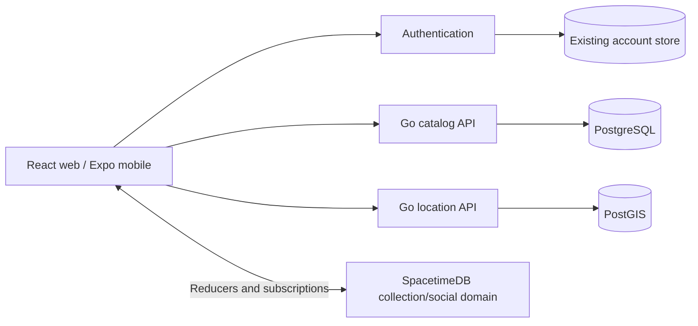

# PokeGoNexus: Backend Evolution and Technology Evaluation

**Status:** Deferred / exploratory  
**Discussion date:** 2026-11-23  
**Intended repository path:** `docs/backend-evolution.md`

This document records the architectural discussion and proposed experiments for when development resumes. It is not an approved implementation plan. PokeGoNexus is currently a lower-priority project; preserve the working system and revalidate repository state, requirements, dependency versions and licenses before undertaking changes.

## 1. Product and architectural intent

- PokeGoNexus is **online-first with temporary offline tolerance**, not a fully offline-first application. The server is authoritative. A user who temporarily loses mobile connectivity should be able to browse cached collection data and queue collection edits until connectivity returns.
- Trades and other multi-user operations remain online and server-authoritative.
- Retain independently deployable and scalable business domains where they offer concrete benefits. Service count, database count and infrastructure complexity are not goals in themselves.
- Prefer self-hosting on owned hardware. Managed cloud services should be optional rather than architectural requirements.
- Preserve the project's value as a portfolio demonstration of conventional distributed systems, while showing the ability to evaluate and simplify a system based on evidence.

## 2. Existing architecture

The repository's [main README](../README.md), [receiver](../receiver/README.md), [storage](../storage/README.md), [events](../reader/events/README.md) and [frontend](../frontend/README.md) guides describe the current baseline.

| Domain | Documented baseline |
| --- | --- |
| Web | React, TypeScript, Vite, Zustand, IndexedDB |
| Mobile | Expo, React Native, SQLite, shared contracts |
| Authentication | Node.js, Express, MongoDB, JWT, per-device sessions |
| Pokémon reference catalog | Go, PostgreSQL, in-process and optional Redis caching |
| Location and discovery | Go, PostgreSQL/PostGIS and MySQL |
| Collection updates | Go receiver, Kafka `batchedUpdates`, Go storage consumer, MySQL |
| Social and trade commands | Synchronous server-authoritative users service |
| Real-time updates | SSE, Kafka, transactional MySQL outbox, pull/reconnect endpoints |
| Delivery and operations | Docker, NGINX, CI/CD, monitoring and backups |

The existing receiver uses deterministic `sync_batch_id` values to support replay protection. Storage performs ownership and stale-write checks, persists changes and refreshes affected rankings. Social/trade operations use synchronous transactions and an application outbox; the documented events service polls that outbox every 200 ms and broadcasts changes to relevant sessions.

This is useful engineering evidence: distributed messaging, data consistency, idempotency, offline recovery, observability, transactional outbox patterns, authorization and deployment. However, the collection pipeline involves several infrastructure components that serve a single tightly related business domain. Their overhead should be measured rather than presumed necessary.

## 3. Candidate architectures

| Candidate | Strengths | Trade-offs |
| --- | --- | --- |
| Existing microservices | Independent stateless workers, durable messaging, buffering, transferable engineering skills | More components, custom synchronization, network hops and operational complexity |
| Consolidated Go + PostgreSQL or existing MySQL | Familiar relational storage and conventional backend, less operational overhead; valuable comparison baseline | Live updates, retries and client synchronization still need implementation |
| SpacetimeDB hybrid | Relational state, transactional reducers, generated bindings, subscriptions, potential removal of several backend components | New programming model, portability and migration risks, authorization, scaling and licensing considerations |
| PowerSync | Replication to persistent client SQLite, queued offline writes, compatible with existing server database/API | Adds a synchronization service; retains the server write API and authoritative database |

**Current exploratory preference: SpacetimeDB for the collection and social domain.** PowerSync was initially favored when the application was understood to be offline-first. The clarified requirement is limited offline tolerance, making SpacetimeDB's authoritative transaction and subscription architecture more interesting. PowerSync remains a credible alternative if robust durable client synchronization becomes the dominant requirement or if retaining the existing backend is more valuable than consolidation.

This is an evaluation priority, not a decision to migrate. Compare against a simpler conventional SQL backend as well as the current distributed implementation.

### 3.1 SpacetimeDB proposal

SpacetimeDB combines a relational database, transactional application logic, persistence and live client subscriptions. It can be self-hosted. Verify the selected release's current features and SDK support before committing to an implementation.

A separately deployed collection/social database could own Pokémon instances, tags, registrations, trades, friendships, blocks and collection visibility where shared ownership is necessary for atomic updates. Reducers should enforce identity, permissions and invariants; scoped subscriptions should synchronize committed changes with relevant clients. Use private tables and authorized views, not public tables with client-side filtering of sensitive data.

Potentially replace the Go receiver, Kafka collection topic/consumers, storage worker, MySQL collection tables and SSE/outbox delivery used solely for migrated state. This is not a driver swap: inventory users/search services, rankings, external event consumers, account mappings and geographic discovery dependencies before changing data ownership. Kafka must remain wherever independent replay, buffering or integration consumers still need it.

Keep the Go catalog/location services, PostgreSQL, PostGIS, NGINX/TLS and existing authentication initially. Evaluate identity federation/token exchange, session revocation and private subscription policies before allowing direct client connections. Existing Go logic may need porting to supported SpacetimeDB module languages; confirm actual language and SDK availability. Verify Expo/React Native compatibility on physical devices.

| Component | Proposed treatment |
| --- | --- |
| MySQL collection/social state | Evaluate replacement by SpacetimeDB |
| Kafka | Remove from migrated paths only if no remaining independent consumers require it |
| Receiver/storage workers | Consolidate only after equivalent behavior is verified |
| SSE and application outbox | Replace with subscriptions where sufficient; retain independent event delivery if needed |
| PostgreSQL catalog | Retain |
| PostGIS | Retain |
| MongoDB authentication | Retain initially; consider a separate PostgreSQL consolidation later |
| Redis | Retain only where measured caching/rate-limiting needs justify it |
| Go | Retain catalog, location, external integrations and other appropriate services |
| IndexedDB / mobile SQLite | Retain durable cached data and offline mutation queue |
| Zustand | Retain UI and optimistic state; avoid unnecessary duplication of authoritative SDK state |

### 3.2 Temporary offline support

SpacetimeDB's subscribed client cache is not automatically durable offline storage. Preserve a narrowly scoped local cache and persistent mutation queue instead of recreating a complete offline-first synchronization platform.

- Queue collection commands with stable mutation IDs and relevant expected versions.
- Apply optimistic local state where appropriate; distinguish pending, acknowledged and rejected operations.
- Reconnect and resubscribe to authoritative state; do not discard unacknowledged edits.
- Retry idempotently with bounded retry policies, authorization and explicit stale-write/conflict rules.
- Surface rejected edits to users and reconcile their local state.
- Keep trades, friendship commands and other multi-user actions online unless requirements explicitly change.
- Verify behavior across reloads, device restarts, account switching, network failures and lost acknowledgments.

### 3.3 PowerSync alternative

PowerSync synchronizes authoritative backend data to local SQLite and maintains client-side mutation queues. Clients upload writes through application-controlled backend logic, which remains responsible for validation, conflict resolution and transactional business rules. Its web and React Native support, source database compatibility and self-hosted edition should be verified for the selected release.

PowerSync could replace much of the custom timestamp-based reconciliation, SSE-based state synchronization and offline queue handling while retaining the existing Go APIs and SQL backend. It does not automatically remove Kafka or the storage worker; removing those requires redesign of the authoritative write path.

If adopting PowerSync, evaluate whether web collection persistence should migrate from IndexedDB to its SQLite-based client layer. TanStack DB integration is an optional candidate, not a requirement. Existing Zustand state can remain for UI concerns.

### 3.4 Independent scaling, hosting and licensing

SpacetimeDB is compatible with separately deployed business domains, but its scaling model differs from replicating stateless Go APIs in front of a conventional database. Transactions within an individual database use a serial execution model. Separate databases may execute independently, but that is not equivalent to horizontally scaling write throughput for one shared database.

Partitioning by user can complicate atomic cross-user trades, social state, rankings and privacy enforcement. Avoid premature sharding. Keep tightly coupled transactional state together; scale unrelated catalog, geography and identity services separately.

Before production adoption, verify:

- The exact self-hosted release, persistence model, resource limits, backup/export and recovery tooling.
- The current Business Source License and production-instance restrictions, including whether proposed replication or sharding requires commercial licensing.
- Standalone versus managed-cloud replication, availability and scaling capabilities. Do not assume roadmap features are delivered.
- Monitoring, upgrade compatibility, security advisories, TLS and reverse-proxy support.

Do not treat the ability to start a local container as evidence of production readiness. Pin versions, use persistent volumes and test disaster recovery.

## 4. Performance: hypotheses rather than promises

SpacetimeDB can reduce application-to-database overhead by colocating logic and data access, maintaining persistent client connections and sending subscribed deltas. Vendor-published benchmarks report very high transaction throughput for some workloads, but throughput is not the same as per-request latency. They do not establish the speed of PokeGoNexus, especially under different durability, authorization, data volume and fan-out requirements.

PowerSync can make local reads and optimistic writes responsive while replication happens in the background. It does not inherently accelerate the authoritative Go/SQL transaction. Nexus already uses cached and optimistic local state, so browsing or editing may not feel noticeably faster with either product.

The most meaningful opportunities are durable write latency, cross-device delivery latency, throughput under load, reconnect costs and operational simplicity. Compare equivalent durable commits and delivery semantics: a Kafka enqueue acknowledgment is not a durable database commit.

## 5. Database and infrastructure strategy

Prefer a small set of technologies selected by workload, rather than keeping multiple databases merely to demonstrate breadth.

| Technology | Intended role / decision |
| --- | --- |
| PostgreSQL | Default conventional server relational database; catalog, accounts if migrated, JSONB and PostGIS |
| MySQL / MariaDB | Mature transactional databases; substantial overlap with PostgreSQL; no need to add MariaDB to Nexus |
| SQLite | Embedded local persistence and offline queues; not redundant with server SQL |
| MongoDB | Document-oriented storage, replication and sharding; evaluate whether account data needs it |
| Redis | Optional fast data structures, caching, rate limiting, queues; introduce/retain based on actual requirements |
| Kafka | Durable replay and independent event consumers; not automatically necessary for live collection synchronization |
| ClickHouse | Specialized analytical database; not a replacement target for SpacetimeDB (relevant to WinRift, not a proposed Nexus dependency) |
| Supabase | Self-hostable PostgreSQL-based backend platform; auth, generated APIs, realtime and storage; alternative to custom services, not a separate database engine |
| Firebase | Managed backend platform; offline/client features, but cloud dependence is less aligned with this project's hosting goals |
| SpacetimeDB | Evaluate for online-first transactional shared state and live subscriptions |
| PowerSync | Evaluate if persistent local replication and offline queue complexity dominate |

Other candidates, only when requirements warrant them:

- [OpenTelemetry](https://opentelemetry.io/): correlate requests, Kafka events, database commits and cross-device delivery. Integrate with existing metrics/monitoring and a trace backend such as Jaeger or Tempo.
- [NATS JetStream](https://docs.nats.io/nats-concepts/jetstream): alternative persistent messaging if Kafka is disproportionately heavy but a broker remains needed. Test durability and replay semantics.
- [River](https://riverqueue.com/): transactional PostgreSQL-backed background jobs if appropriate work moves to PostgreSQL.
- [OpenFGA](https://openfga.dev/): relationship-based authorization if existing ownership/privacy rules justify an additional service.
- [Testcontainers](https://testcontainers.com/): reproducible integration tests with real database and broker dependencies.

## 6. Evaluation roadmap (deferred until work resumes)

1. **Preserve baseline.** Record a tagged revision, architecture diagram, deployment inventory and reproducible performance/correctness baseline. Preserve existing distributed-systems portfolio evidence.
2. **Instrument.** Measure the current pipeline end-to-end, ideally using correlated OpenTelemetry traces where appropriate.
3. **Prototype.** On a separate branch with synthetic data, implement a collection edit, two connected clients, temporary offline replay and one atomic trade with equivalent authorization. No production users or data.
4. **Compare.** Test the existing system, a consolidated Go/SQL control and SpacetimeDB under matched conditions. Prototype PowerSync if the offline trade-offs warrant it.
5. **Validate.** Exercise concurrent edits, stale versions, replay, unauthorized writes/reads, blocked users, private collections, trade double acceptance, dropped connections, lost acknowledgments, service restart and backup/restore.
6. **Decide.** Write an architecture decision record with results, independent scaling limits, operational risks, migration boundaries and a rollback plan. Do not adopt without measurable benefits and correctness parity.
7. **Migrate only after acceptance.** Inventory dependencies, verify data export/import and integrity, validate the cutover and preserve a tested rollback path. Avoid combining auth/database consolidation with the first migration.

### Benchmark checklist

| Measure | Required comparison |
| --- | --- |
| Durable transaction latency | p50/p95/p99, success and rejection |
| Cross-device synchronization | Commit to observed update, p50/p95/p99 |
| Throughput | Sustained transactions per second under realistic read/write mix |
| Concurrency | Connected clients, subscriptions, contention and fan-out |
| Initial load and reconnect | Time, transferred bytes, retained local data |
| Offline replay | Duplicate handling, reconciliation and recovery after restart |
| Resource usage | CPU, RAM, disk, network and storage growth |
| Operations | Container count, deployments, health checks, backups and recovery |
| Code and architecture | Owned custom synchronization code, dependency coupling and maintainability |

Use equivalent data volumes, indexes, durability, security, network and hardware. Report reproducible settings, warm/cold runs, failures and uncertainty. Avoid extrapolating vendor benchmarks to this application.

## 7. Portfolio strategy

The existing architecture demonstrates Go/Node services, Kafka, SQL and NoSQL, event-driven workflows, transactional integrity, offline tolerance, Docker/NGINX and observability. Replacing it without preserving its evidence would discard a useful demonstration of transferable skills.

A stronger case study is architectural evolution: document why the original design existed, compare alternatives, measure trade-offs, simplify only where evidence supports it and preserve the earlier implementation as a tagged baseline. Resume claims should report measured results, not hypothetical improvements or technology count.

## References and revalidation

- [SpacetimeDB documentation](https://spacetimedb.com/docs/) and [vendor benchmarking](https://spacetimedb.com/blog/benchmarking)
- [PowerSync documentation](https://docs.powersync.com/)
- [Supabase self-hosting](https://supabase.com/docs/guides/self-hosting)
- [Current collection synchronization](../README.md#collection-sync)

This document is a record of discussion, not permission to modify production or an instruction for an agent to implement the roadmap automatically.
